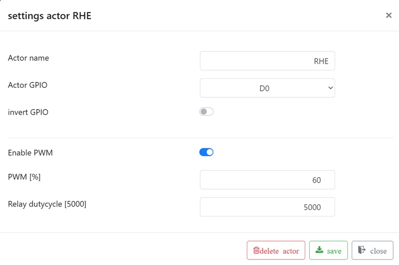
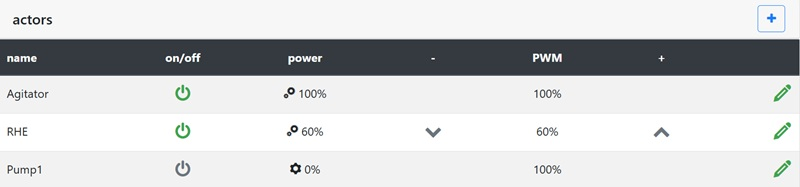
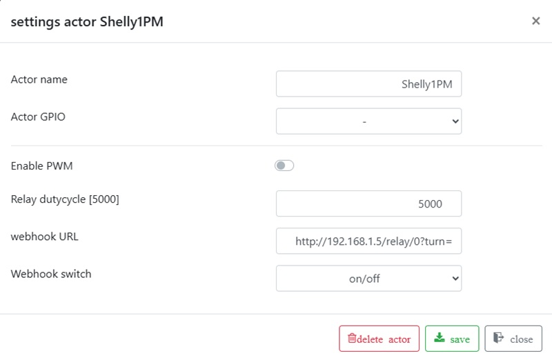

# Aktoren

Aktoren wie Rührwerk, Pumpen oder Ringheizelemente werden mit einem Namen und einem GPIO (Schalter) konfiguriert. Aktoren können PWM (Pulsweitenmodulation) verwenden. PWM im Brautomat bedeutet je nach PWM-Modus entweder getaktetes Ein-/Ausschalten oder ein analoges PWM-Signal.

Bei Relais bedeutet PWM ein getaktetes Ein- und Ausschalten zur
Leistungsregelung, nicht eine stufenlose Drehzahlregelung.

Für Relais und SSRs wird die digitale PWM verwendet. Die Leistung wird in Prozent angegeben. 100% bedeutet dauerhaft eingeschaltet. 50% bedeutet, dass der Ausgang innerhalb eines festen Zyklus jeweils zur Hälfte eingeschaltet und ausgeschaltet ist. Der digitale PWM-Zyklus ist fest auf 5000 ms eingestellt. Die Leistung wird in 5%-Schritten verarbeitet. Ein separater Dutycycle-Parameter wird für Aktoren nicht mehr konfiguriert.

Für analoges PWM wird ein festes PWM-Signal mit 1000 Hz verwendet. Dieser Modus ist für geeignete PWM-Eingänge gedacht, nicht für das Takten von Relais.

Numerische Aktorbefehle im Maischeplan geben die aktuelle PWM-Leistung vor.
Der konfigurierte PWM-Wert bleibt der Einschaltwert für die manuelle Bedienung.
Beim Löschen eines Aktors behalten nachrückende Aktoren ihren Laufzustand.
Bereits durch Kessel, Sensoren oder Systemfunktionen belegte GPIOs können
nicht zusätzlich einem Aktor zugewiesen werden.

Die Leistung kann während des Betriebs mit den beiden Schaltflächen in der Aktorentabelle geändert werden. Die Schaltflächen zum Ändern der Leistung sind für jeden Aktor sichtbar, wenn PWM für den Aktor aktiviert wurde. Digitale PWM ist für Relais oder SSRs geeignet. Sie ist nicht als direkte Motorsteuerung für Rührwerke gedacht.

## Webhook

Beim Bearbeiten oder Löschen wird das bisherige Webhook-Ziel abgeschaltet.
AUS-Aufträge werden bei Verbindungsfehlern und HTTP-Fehlerstatus wiederholt.
Solange AUS nicht mit HTTP 2xx bestätigt ist, wird für dasselbe Ziel kein
neuer EIN-Auftrag angenommen. Fehlgeschlagene EIN-Aufträge werden nicht
automatisch wiederholt. Eine HTTP-Bestätigung ist kein physischer Schalt-Rückkanal.
Ein Neustart wartet auf die Bestätigung ausstehender AUS-Aufträge und kann
deshalb bei einem dauerhaft unerreichbaren Webhook-Ziel ausstehen bleiben.
Ist der Auftragsspeicher voll, wird eine Zieländerung abgewiesen, anstatt
den AUS-Auftrag des bisherigen Ziels zu verlieren.

Der Parameter Aktor GPIO muss auf "-" eingestellt werden, damit die Webhook-Elemente im Webinterface angezeigt werden. Zusätzlich werden die Webhook-URL und das Schaltkommando benötigt:

Ab 1.71 darf die Basis-URL bis zu 127 ASCII-Zeichen lang sein.
Der Brautomat hängt den gewählten Schaltwert automatisch an.

| Gerät | Basis-URL | Schaltwerte |
| --- | --- | --- |
| Shelly Gen1 | `http://192.168.1.5/relay/0?turn=` | `on/off` |
| Shelly Gen2 | `http://192.168.1.5/rpc/Switch.Set?id=0&on=` | `true/false` |
| Shelly Gen3 | `http://192.168.1.5/rpc/Switch.Set?id=0&on=` | `true/false` |
| Tasmota | `http://192.168.1.5/cm?cmnd=Power1%20` | `1/0` |
