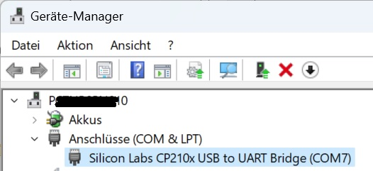
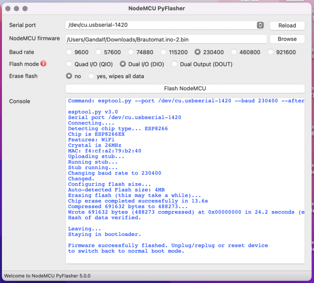
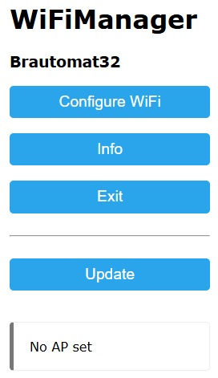
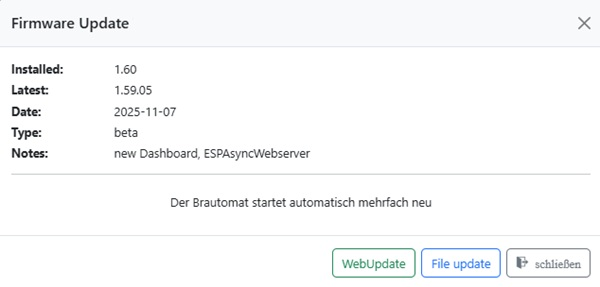
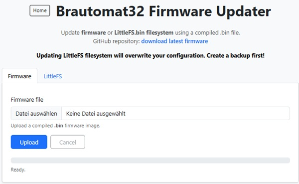

# Installation

Um den Brautomat zu nutzen, musst du die Firmware flashen und den ESP32 mit
deinem lokalen WLAN verbinden.

## Empfohlener Weg: Brautomat32 ServiceTool

Das [Brautomat32 ServiceTool](https://github.com/InnuendoPi/ServiceTool) ist
die empfohlene Anwendung für Installation, Betrieb und Wartung des Brautomats.
Es bündelt Firmware- und Webdatei-Update, WLAN-Einrichtung, Backups,
Planverwaltung und das serielle Protokoll.

### ServiceTool herunterladen und starten

1. Lade die passende aktuelle **Release-Version** von den
   [ServiceTool-Releases](https://github.com/InnuendoPi/ServiceTool/releases)
   herunter und entpacke sie in einen eigenen Ordner.
2. Starte unter Windows `Brautomat32ServiceTool.exe`.
   Unter Linux mache die AppImage-Datei ausführbar und starte sie; unter macOS
   öffne `Brautomat32ServiceTool.app`.
3. Warte nach dem Start einige Sekunden, bis das ServiceTool die Verbindung
   über USB und im Netzwerk geprüft hat.

### Ersteinrichtung mit dem ServiceTool

1. Verbinde genau einen Brautomat per USB mit dem Computer.
2. Öffne **Assistenten → Brautomat einrichten** und folge den Schritten
   für Firmware und WLAN. Beim kompletten Neueinrichten gehen vorhandene
   Daten verloren. Erstelle bei Bedarf vorher ein Backup.
3. Warte, bis der Brautomat im WLAN erreichbar ist.

Nach dem ersten Flashen und der WLAN-Einrichtung folgt der
[Sicherheits-Check vor erstem Heiztest](sicherheitscheck-erster-heiztest.md).
Danach geht es mit der [Grundeinrichtung](../Grundeinrichtung/info.md) weiter.

> **Hinweis:** Der manuelle Weg über das ZIP-Archiv und `Flashen.cmd` bleibt
> als technischer Fallback verfügbar, falls das ServiceTool nicht genutzt
> werden kann.

## Auf 1.71 Development migrieren

Für den Wechsel von 1.66.x auf 1.71 ist eine USB-Migration auf das
neue IDF6-Layout erforderlich. Verwende ServiceTool ab Version 2.1.0.

1. Beende laufende Brau- und Gärprozesse. Verbinde den Brautomat per USB
   und prüfe, ob er auch im WLAN erreichbar ist.
2. Öffne **Service → Migration** und wähle manuell **IDF6 Development**.
   Prüfe den COM-Port und die angezeigte Zielversion.
3. Wähle **Migration starten**. Das ServiceTool sichert die Daten,
   schreibt das neue Flash-Layout samt Hauptfirmware und ServiceApp und
   spielt die Sicherung zurück. Lass USB und Strom bis zum Abschluss verbunden.

## Manueller Fallback: Firmware flashen mit Windows

- [Stabile Version](https://github.com/InnuendoPi/Brautomat32/releases/latest)
- [1.71 Development (IDF6)](https://github.com/InnuendoPi/Brautomat32/raw/refs/heads/development/Updates/ESP32-IDF6dev/Brautomat32.zip)

Verwende für eine Neuinstallation das `Flashen.cmd` aus dem gewählten
Paket. Das Skript überschreibt auch LittleFS. Wenn du vorhandene Daten
übernehmen willst, folge der [Migrationsanleitung](#auf-171-development-migrieren).

1. ZIP-Archiv entpacken.
2. ESP32 per USB mit PC/Notebook verbinden.
3. `Flashen.cmd` per Doppelklick starten.

Windows legt beim Verbinden in der Regel automatisch einen seriellen COM-Port
an.



Falls kein COM-Port erscheint, installiere passende USB-Treiber:

[](https://www.silabs.com/developers/usb-to-uart-bridge-vcp-drivers?tab=downloads)

`Flashen.cmd` nutzt `esptool.exe`:
<https://github.com/espressif/esptool>

### Manuelles Flashen (MS Windows, macOS, Linux)

Die folgenden Befehle gelten für 1.66.x. Bei 1.71 muss zusätzlich die
ServiceApp geschrieben werden. Verwende für 1.71 das mitgelieferte
`Flashen.cmd` unter Windows oder das ServiceTool.

Schritt 1 - Flash löschen:

```bash
esptool.exe --chip esp32 erase-flash
```

Schritt 2 - Firmware und Dateisystem schreiben:

```bash
esptool.exe --chip esp32 --baud 921600 --before default-reset --after hard-reset write-flash 0x1000 bootloader.bin 0x8000 partitions.bin 0xe000 boot_app0.bin 0x10000 firmware.bin 0x350000 LittleFS.bin
```

### Firmware flashen mit macOS

Download: [pyflasher](https://github.com/marcelstoer/nodemcu-pyflasher/releases)

Diese Schritte gelten für 1.66.x. Verwende für 1.71 unter macOS das
ServiceTool.

Für 1.66.x erfolgt das Flashen in zwei Schritten.

1. Firmware mit pyflasher installieren (`firmware.bin`).
   Hinweis: Je nach Tool/Archiv kann die Datei auch als
   `brautomat.ino.bin` bezeichnet sein.
2. Nach WLAN-Verbindung das Dateisystem installieren (`LittleFS.bin`).



Update-Seite im Browser:
<http://brautomat.local/update>

## WLAN-Konfiguration

Nach dem Flashen startet Brautomat im Access-Point-Modus.
Das offene WLAN `Brautomat32` wird sichtbar.

1. Mit `Brautomat32` verbinden.
2. Falls das Portal nicht automatisch öffnet, `http://192.168.4.1` aufrufen.
3. SSID und Passwort eintragen.
4. Mit `Save` speichern.



Danach startet Brautomat neu und ist im lokalen WLAN erreichbar unter:
<http://brautomat.local>

Damit ist die Grundinstallation abgeschlossen.

Vor dem ersten Heiztest:
[Sicherheits-Check vor erstem Heiztest](sicherheitscheck-erster-heiztest.md)

Anschließend mit der [Grundeinrichtung](../Grundeinrichtung/info.md)
weitermachen.

> **Hinweis:**
> Brautomat32 versucht bis zu 20 Sekunden, sich mit der gespeicherten WLAN-
> Konfiguration zu verbinden.
> Bei falschem Passwort oder zu schwachem Signal startet wieder der
> Access-Point-Modus.

## Updates

Updates können im Menü `Update` eingespielt werden:

- `WebUpdate`: aktuelle Version direkt aus GitHub laden
- `DateiUpdate`: Bei 1.66.x eine Firmwaredatei vom lokalen Rechner hochladen

Für Updates innerhalb einer kompatiblen Firmwaregeneration ist kein
USB-Kabel erforderlich. Für den Wechsel auf das IDF6-Layout gilt die
[Migrationsanleitung](#auf-171-development-migrieren).

Der ESP32-Speicher ist in Firmware und Dateisystem getrennt.
Bei einem Update wird die Firmware neu installiert.
Im Dateisystem werden je nach Update einzelne Dateien ersetzt.

Firmware und Weboberfläche müssen zum selben Versionsstand gehören. Nach einem
Update die geöffneten Brautomat-Seiten neu laden. Zeigt der Browser weiterhin
die alte Oberfläche, einmal ohne Browsercache neu laden. Falls beim
Fermenterplan das Minutenfeld fehlt oder das Speichern wegen einer veralteten
Oberfläche abgewiesen wird, die passenden Webdateien des Updates prüfen.

### Wichtig bei Update von 1.59 (oder älter) auf 1.60

Beim Umstieg gelten folgende Punkte:

- `config.txt` wird als `config.old.txt` gesichert.
- PID-Parameter werden auf `0.0` zurückgesetzt.
- AutoTune muss einmal neu durchgeführt werden.

So wird eine saubere Regelung mit dem 1.60-Stand sichergestellt.

### WebUpdate



WebUpdate startet Brautomat mehrfach neu.
Zuerst wird die Firmware aktualisiert, danach weitere Komponenten.
Der Ablauf wird in `webUpdateLog.txt` protokolliert.

WebUpdate bleibt beim passenden IDF6-Kanal. Ein Wechsel zwischen Release
und Development kann eine USB-Installation mit dem ServiceTool erfordern.

### DateiUpdate bei 1.66.x

Ablauf für Firmware-Update per Datei:

1. Aktuelle ZIP-Version herunterladen.
2. ZIP entpacken.
3. Im Webinterface `Update -> DateiUpdate` öffnen.
4. `firmware.bin` auswählen.
5. `Update Firmware` starten.



Auch das Dateisystem kann aktualisiert werden.

> **Hinweis:**
> `Update FileSystem` erstellt das Dateisystem neu und überschreibt
> Einstellungen, Profile und Rezepte.
> In den meisten Fällen: zuerst Firmware per Datei aktualisieren, danach
> WebUpdate ausführen.
