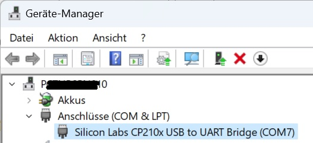
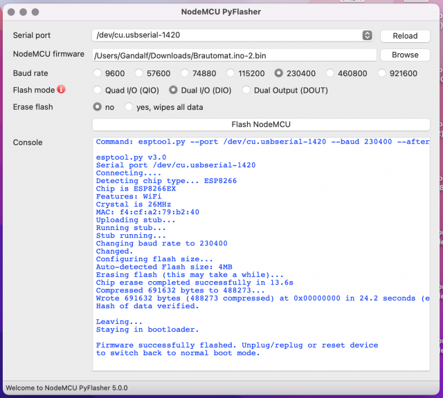
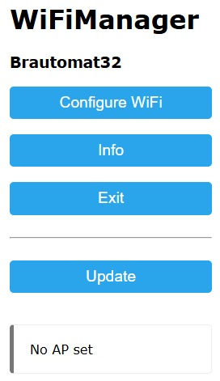
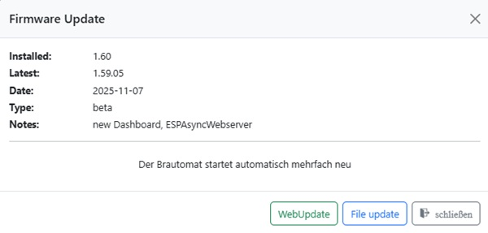
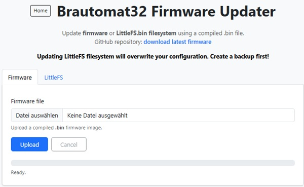

# Installation

To use Brautomat, you need to flash the firmware once and connect the ESP to your local Wi-Fi.

## Recommended approach: Brautomat32 ServiceTool

The [Brautomat32 ServiceTool](https://github.com/InnuendoPi/ServiceTool) is
the recommended application for installing, operating, and maintaining your
Brautomat. It combines firmware and web-file updates, Wi-Fi setup, backups,
plan management, and the serial log.

### Download and start the ServiceTool

1. Download the appropriate current **release version** from the
   [ServiceTool releases](https://github.com/InnuendoPi/ServiceTool/releases)
   and extract it into its own folder.
2. On Windows, start `Brautomat32ServiceTool.exe`. On Linux, make the AppImage
   executable and start it; on macOS, open `Brautomat32ServiceTool.app`.
3. After startup, wait a few seconds while the ServiceTool checks USB and
   network connectivity.

### First setup with the ServiceTool

1. Connect a single Brautomat to the computer by USB.
2. Open **Assistants → Set up Brautomat** and follow the firmware and Wi-Fi
   steps. A complete reset removes existing data. Back up first if you
   need to keep it.
3. Wait until the Brautomat is reachable over Wi-Fi.

After the first flash and Wi-Fi setup, continue with the
[safety check before the first heat test](safety-check-first-heat-test.md).
Then continue with [Basic Setup](../Grundeinrichtung/info.md).

> **Note:** The manual ZIP archive and `Flashen.cmd` method remains available
> as a technical fallback if the ServiceTool cannot be used.

## Migrate to 1.71 Development

To move from 1.66.x to 1.71, use ServiceTool 2.1.0 or later to migrate
to the new IDF6 flash layout over USB.

1. Stop any brewing or fermentation process. Connect Brautomat by USB
   and check that it is also reachable over Wi-Fi.
2. Open **Service → Migration** and manually select **IDF6 Development**.
   Check the serial port and the displayed target version.
3. Select **Start migration**. ServiceTool backs up the data, writes the
   new flash layout with the main firmware and ServiceApp, and restores
   the backup. Keep USB and power connected until migration finishes.

## Manual fallback: flash firmware on Windows

- [Download Release](https://github.com/InnuendoPi/Brautomat32/releases/latest)
- [1.71 Development (IDF6)](https://github.com/InnuendoPi/Brautomat32/raw/refs/heads/development/Updates/ESP32-IDF6dev/Brautomat32.zip)

For a fresh installation, use the `Flashen.cmd` included in the
selected package. It overwrites LittleFS. To keep existing data, follow
the [migration guide](#migrate-to-171-development).

1. Unpack the ZIP archive.
2. Connect ESP32 to your PC via USB.
3. Run `Flashen.cmd`.

Windows normally creates a COM port automatically when the ESP is connected.



If no COM port appears, install the appropriate USB drivers:

[](https://www.silabs.com/developers/usb-to-uart-bridge-vcp-drivers?tab=downloads)

`Flashen.cmd` uses `esptool.exe`:
<https://github.com/espressif/esptool>

The 64-bit Windows binary is included in the ZIP archive.

### Manual flashing (Windows, macOS, Linux)

The commands below apply to 1.66.x. Version 1.71 also requires flashing
ServiceApp. For 1.71, use the included `Flashen.cmd` on Windows or use
ServiceTool.

ESP32 step 1 - erase flash:

```json
esptool.exe --chip ESP32 erase-flash
```

ESP32 step 2 - write firmware and filesystem:

```json
esptool.exe --chip ESP32 --baud 921600 --before default-reset --after hard-reset write-flash 0x1000 bootloader.bin 0x8000 partitions.bin 0xe000 boot_app0.bin 0x10000 firmware.bin 0x350000 LittleFS.bin
```

### Flashing with macOS

Download: [pyflasher](https://github.com/marcelstoer/nodemcu-pyflasher/releases)

These steps apply to 1.66.x. For 1.71 on macOS, use ServiceTool.

Flashing 1.66.x takes two steps.
First flash firmware (`firmware.bin`) with pyflasher. Depending on the tool or
archive, the file can also be named `brautomat.ino.bin`.



Then connect Brautomat to Wi-Fi and open:
<http://Brautomat.local/update>

Use the `File system` button to upload `LittleFS.bin`.

## Wi-Fi configuration

After flashing, Brautomat starts in Access Point mode.
An open Wi-Fi named `Brautomat32` appears.

Connect to it, then open the Wi-Fi portal.
If it does not open automatically, go to:
<http://192.168.4.1>



Enter SSID and password, then click `Save`.
Brautomat restarts and connects to your Wi-Fi.
The web UI is then available at:
<http://Brautomat.local>

At this point, basic installation is complete.

Before the first heat run: [Safety check before first heat test](safety-check-first-heat-test.md)

Then continue with _Basic Setup_.

> **Note:**  
> Brautomat32 tries to connect to configured Wi-Fi for about 20 seconds.  
> If connection fails (for example wrong password), it returns to Access Point mode.

## Updates

Use the `Update` menu for firmware updates.

Available paths:

- `WebUpdate`: download and install directly from GitHub
- `FileUpdate`: upload a firmware file on 1.66.x

Updates within a compatible firmware generation can run without USB.
For the move to the IDF6 layout, follow the
[migration guide](#migrate-to-171-development).

The ESP memory is split into firmware and filesystem.
During normal operation, settings/recipes live in the filesystem.
During updates, firmware is replaced and filesystem files can be updated.

Firmware and web interface must belong to the same version. Reload open
Brautomat pages after an update. If the browser still shows the old interface,
reload once without the browser cache. If the fermentation plan has no minutes
field or saving is rejected because the interface is outdated, check that the
matching web files from the update are installed.

### Important when upgrading from 1.59 (or older) to 1.60

- `config.txt` is saved as `config.old.txt`
- PID parameters are reset to `0.0`
- Run AutoTune once after update

This ensures temperature control behaves correctly on 1.60.

### WebUpdate



WebUpdate restarts Brautomat multiple times.
First firmware is updated, then framework/filesystem-related components.
Progress is written to `webUpdateLog.txt`.

WebUpdate uses the matching IDF6 channel. Switching between Release and
Development may require USB installation with ServiceTool.

### FileUpdate on 1.66.x

Firmware FileUpdate workflow:

1. Download current ZIP release.
2. Unpack the ZIP archive.
3. Open Brautomat `Update` -> `FileUpdate`.
4. Select `firmware.bin`.
5. Click `Update Firmware`.



You can also update the filesystem.

> **Note:**  
> `Update FileSystem` rebuilds the filesystem and overwrites settings, profiles, and recipes.  
> In most cases, update firmware first and then use WebUpdate for file-level updates.
