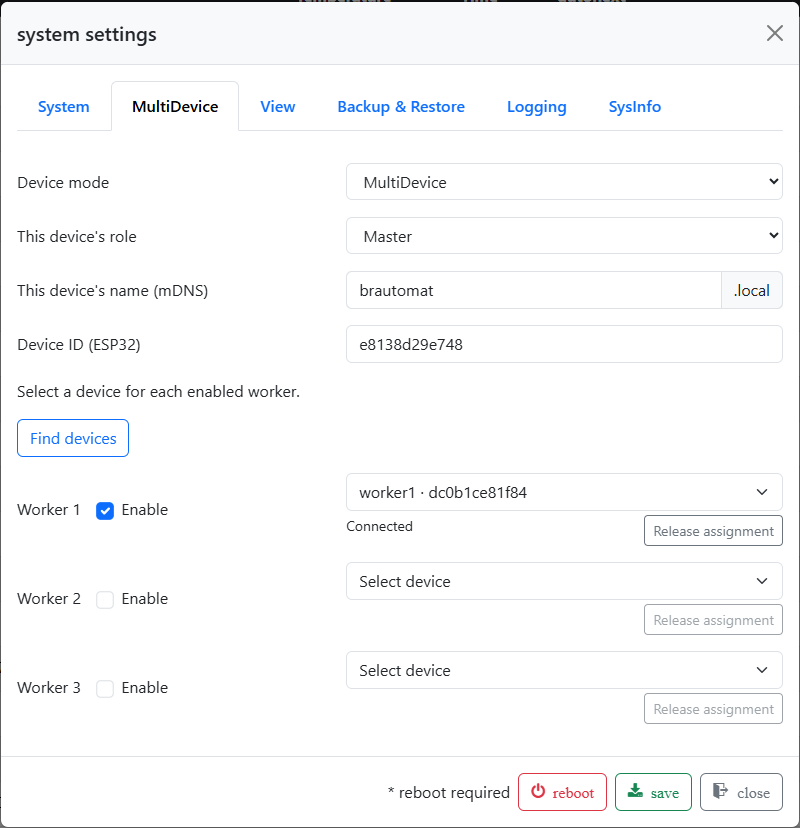
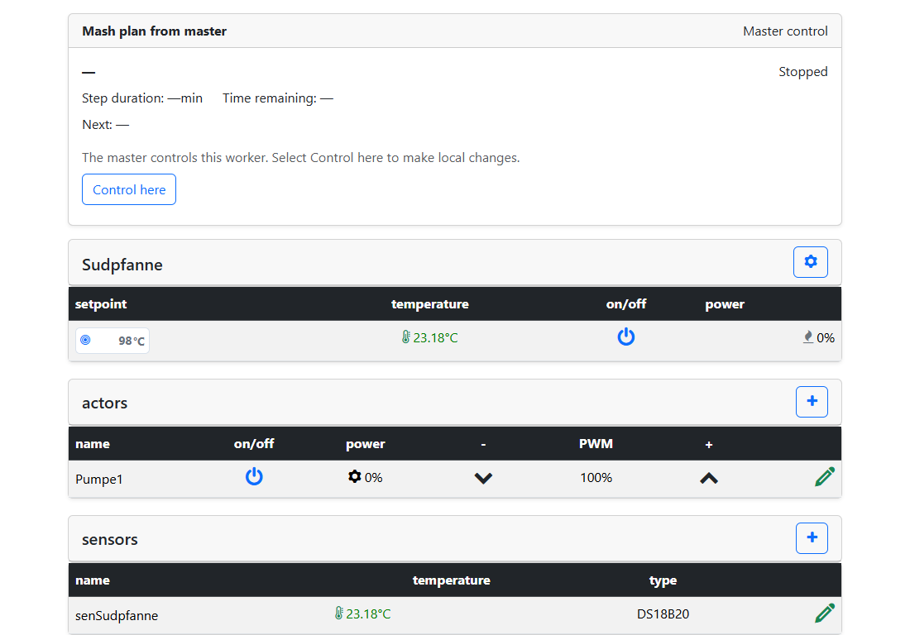
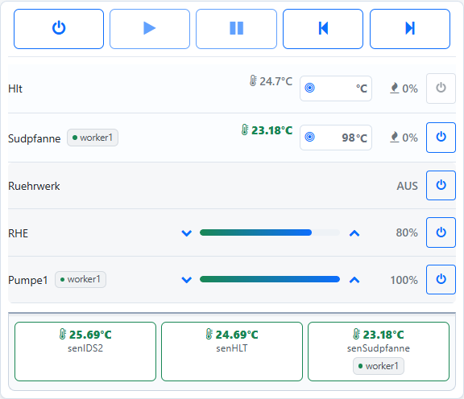
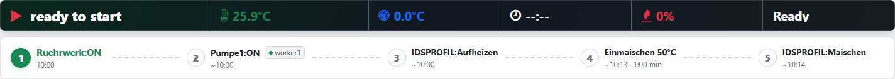
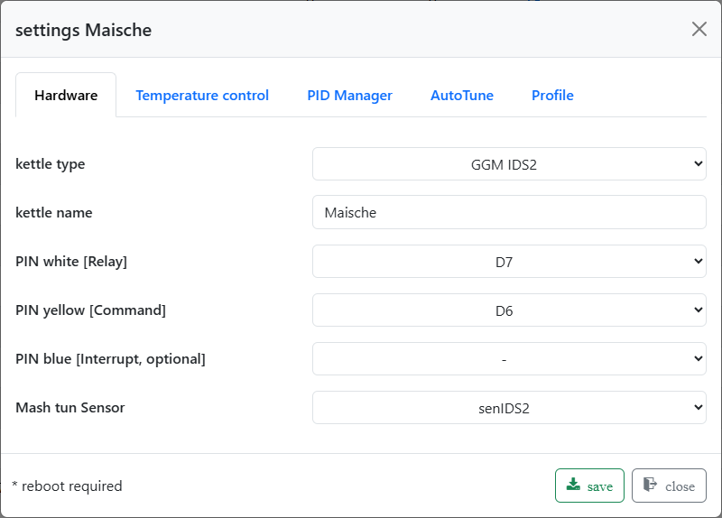

# What's new in 1.71.0?

**1.71.0 Development** moves Brautomat32 to ESP-IDF 6.1.1 and
Arduino 4.0.0.

## MultiDevice: one brewery, several Brautomat units

One **Master** provides the shared controls. Up to **three Workers** provide
their kettles, sensors and actuators. The units communicate over Wi-Fi on your
local network.

You can split your setup by function or location: for example, one Worker at the
mash kettle, another at the boil kettle and a third at the hot liquor tank.
Sensor and control wiring connects to the nearby Brautomat. This simplifies
wiring and provides additional connections for equipment.

- The Master can be a control station with no equipment connected to it.
- The Master searches for other Brautomat units on the local network. Their
  individual ESP32 identifiers distinguish them independently of their names.
- Small Worker badges in the shared web interface show where equipment is
  connected. Local equipment on the Master does not need a badge.
- The mash plan can use kettles and actuators on Workers.
- Each Worker can have its own Nextion HMI display.
- A compact plan view in the Worker's web interface shows the current Master
  step, temperatures, step duration, remaining time and the next step.

If you use a single Brautomat, you can continue operating it as a SingleDevice
setup. MultiDevice is optional.

*Worker1 is assigned and connected. Two more Worker slots are available.*

### Kettles and controls

The combined setup uses **one kettle per role**: mash/boil (MaischeSud), boil
(Sud), and hot liquor tank (HLT). These roles are not tied to the Master or a
particular Worker. A kettle's temperature sensor must be connected to the same
Brautomat as the kettle.

If several kettles are configured for the same role, selection while the plan
is stopped follows **Master → Worker1 → Worker2 → Worker3**. Assignments remain
fixed while a plan is running or paused. A connection failure does not
automatically select a different kettle.

To make local adjustments on a Worker, select **“Take control”**. Return control to the Master
through the web interface after the states have been reconciled. Returning
control itself changes neither setpoints nor outputs; a paused mash plan is
then resumed explicitly. Manual mode remains local. Fermentation plans require
SingleDevice; they are unavailable on both Masters and Workers in MultiDevice mode.

*The Master plan card sits above the local equipment. The plan is stopped in this screenshot.*

For details, see [MultiDevice](../MultiDevice/info.md),
[Setup](../MultiDevice/setup.md) and [Operation](../MultiDevice/operation.md).

## A clearer view of your brew

- Consistent controls for local and remote kettles and actuators.
- Temperature and rate of temperature change arranged clearly; the rate is
  hidden when a kettle is switched off.
- Continuously updated estimates for upcoming mash plan steps. These remain
  approximate: unspecified waiting times, such as during lautering, can only
  be accounted for when you actually continue.
- Error toasts remain visible until you close them yourself.

*Local equipment and the Worker’s kettle, pump and sensor appear together. Worker badges identify their source.*

*The “Pumpe1:ON” command shows its Worker assignment. Times are estimates before brewing starts.*

## Partition layout and ServiceApp

Flash memory is divided differently: the main firmware gets a larger area,
with a separate **ServiceApp** alongside it. ServiceApp handles maintenance
tasks such as installing the main firmware and backing up or restoring files.
Brewing does not run while ServiceApp is active.

ServiceApp and ServiceTool are different components: **ServiceApp runs on the
Brautomat**, while **ServiceTool runs on your computer**. After migration, the
main firmware's normal web update uses ServiceApp.

## Moving to 1.71

To move from 1.66.x to 1.71, use ServiceTool 2.1.0 or later to migrate
over USB. The installation guide explains how to select
**IDF6 Development** manually and how backup and restore work.

[Migrate to 1.71 Development](../Installation/info.md#migrate-to-171-development)

## Other changes since 1.66.6

- **Mash and fermentation plan** filenames retain spaces and accented
  letters. New names can contain up to 50 characters including `.json`.
- The recovery access point provides a Wi-Fi setup page. Additional
  languages are downloaded separately on demand.
- The piezo GPIO selector displays the saved value. `-` disables the buzzer.
- Webhook base URLs can contain up to 127 ASCII characters. The
  `true/false` option supports devices such as Shelly Gen2 and Gen3.

## Optional IDS feedback channel

GPIO selection for the GGM IDS hob's interrupt input (blue wire) is available
again. **The interrupt is disabled by default** and can be enabled if needed.

To reduce false alarms, an error is displayed only after three identical codes
have been received consecutively. `0000` means OK. The notification itself does
not pause a plan or automatically switch off heating or a relay. Feedback from
real installations will guide further evaluation of this behaviour.

*The blue-wire interrupt pin is set to “–”: the optional feedback channel is disabled.*

## Development status

Development is supported by automated checks and initial device tests.
Trials on real breweries, with several Workers and different Wi-Fi setups,
will help identify where further adjustments are needed.

When reporting an issue, please include the firmware versions, your Master/Worker
setup, the affected step and a short description of what happened.
