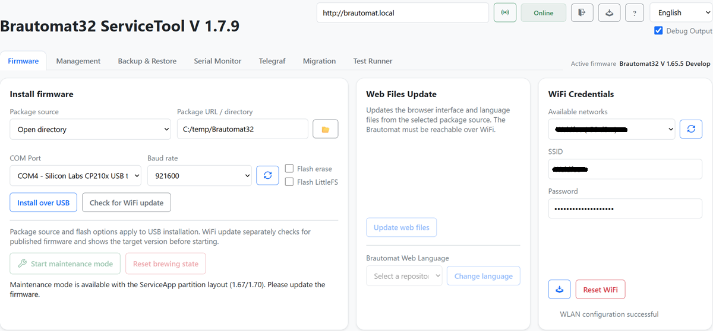
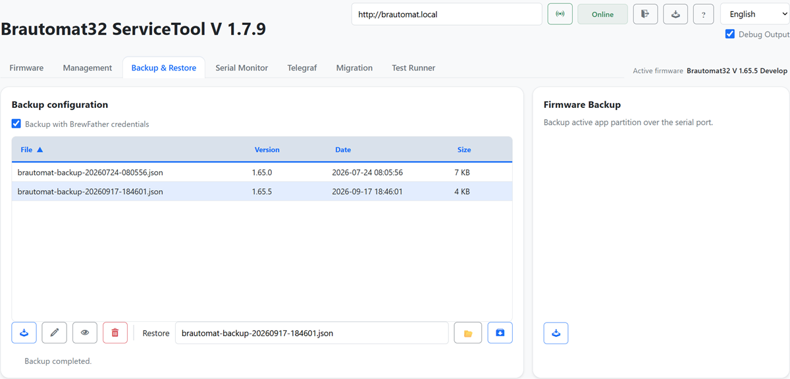
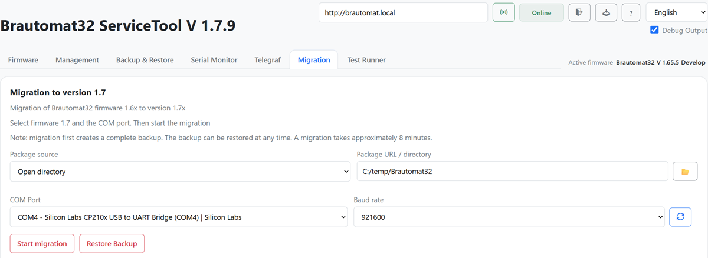

# Migration auf 1.70

Diese Kurzanleitung beschreibt die **einmalige Umstellung vom bisherigen
Partitionslayout auf das neue Layout mit ServiceApp**. Danach sind normale
WebUpdates wieder möglich. Bereits umgestellte Geräte benötigen keine erneute
Layoutmigration.

> **Ein WebUpdate von 1.66.x oder älter auf 1.70 ist nicht möglich.**
> Verwendet das [aktuelle ServiceTool](https://github.com/InnuendoPi/ServiceTool/releases/latest)
> mit Unterstützung für die Migration auf 1.70 und das vollständige 1.70-Paket.
> Die Umstellung erfolgt per USB; eine einzelne `firmware.bin` reicht nicht aus.

## 1. Gerät verbinden

Braubetrieb beenden und den Brautomat mit einem USB-Datenkabel am Computer
anschließen. ServiceTool öffnen, den richtigen Port und die Geräteadresse
auswählen. Der bisherige Brautomat muss auch über WLAN erreichbar sein.
Warten, bis das ServiceTool das richtige Gerät als **Online** erkennt.

*Bild 1: ServiceTool mit markiertem Port, Geräteadresse und Online-Status.*

## 2. Daten sichern

Unter **Backup & Restore** eine Sicherung erstellen und auf dem Computer
aufbewahren. Prüfen, dass Einstellungen, eigene Rezepte und Profile gesichert
sind; zusätzlich benötigte eigene Dateien separat sichern. Die Sicherung bis
zum erfolgreichen Abschluss behalten.

*Bild 2: Backup & Restore – Sicherung erstellen und erfolgreiches Ergebnis.*

## 3. Paket auswählen

Zum Bereich **Migration** wechseln und das vollständige 1.70-Paket auswählen.
Für ein lokal gespeichertes Paket die ZIP-Datei zuerst entpacken und den Ordner
über **Open directory** auswählen. Das Paket enthält die Partitionstabelle,
Hauptfirmware, ServiceApp, LittleFS und die passenden Webdateien.
Den richtigen COM-Port auswählen und Gerät sowie Zielversion prüfen.

*Bild 3: Migration mit lokalem Paketordner, COM-Port und Startschaltfläche.*

## 4. Migration starten

**Migration starten** wählen. Den vollständigen Ablauf einschließlich Sicherung,
Flashen, Neustart und Wiederherstellung abwarten.

**Währenddessen weder Stromversorgung noch USB-Verbindung trennen und das
ServiceTool nicht schließen.** Erst fortfahren, wenn der Ablauf erfolgreich
abgeschlossen ist und der Brautomat wieder erreichbar ist.

## 5. Ergebnis prüfen

- Webinterface des Brautomaten neu laden und **Version 1.70.x entsprechend dem gewählten Paket** prüfen.
- WLAN, Sensorwerte, Kesselzuordnungen, Aktoren, Profile und eigene Rezepte prüfen.
- Fehlende Daten über den vorgesehenen Restore-Ablauf aus der Sicherung übernehmen.
- Vor dem nächsten Brautag die Funktionen der eigenen Anlage kontrollieren.

Die ServiceApp ist der Wartungsbereich auf dem Brautomat. Nach der Umstellung
soll wieder die normale Hauptfirmware mit ihrem Webinterface laufen.
MultiDevice anschließend bei Bedarf einrichten; jedes weitere Gerät einzeln
migrieren und prüfen. Ein einzelner Brautomat bleibt weiterhin nutzbar.

## Wenn etwas nicht klappt

Fehlermeldung und ServiceTool-Protokoll sichern. Nicht auf Verdacht den Flash
löschen oder ein anderes Paket verwenden. Bei fehlender WLAN-Verbindung Port
und Zugangsdaten im ServiceTool prüfen. Für Rückfragen helfen die Tool-Version,
das verwendete Paket und das gespeicherte Protokoll.
